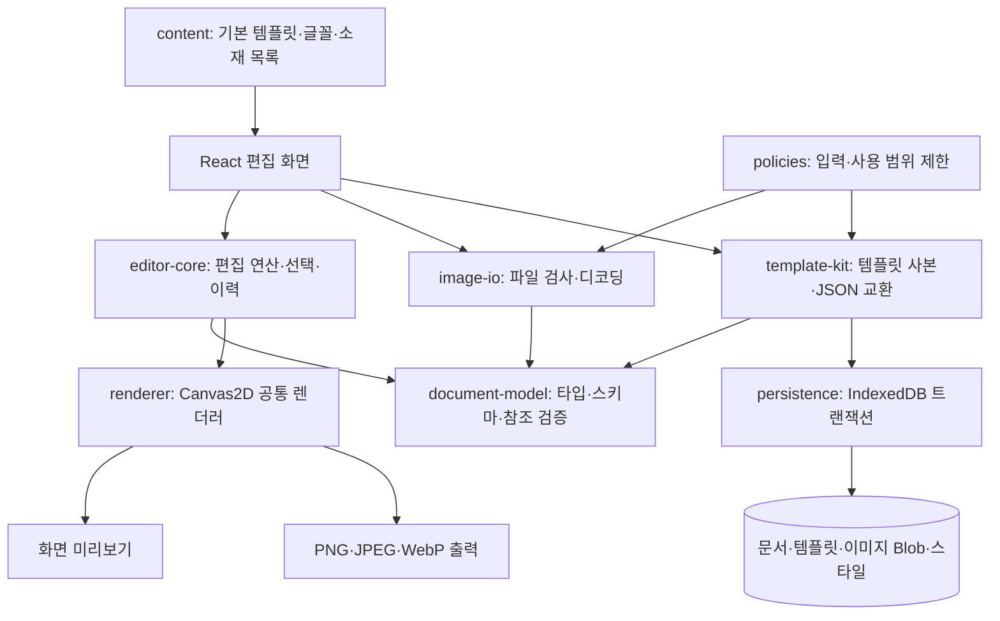
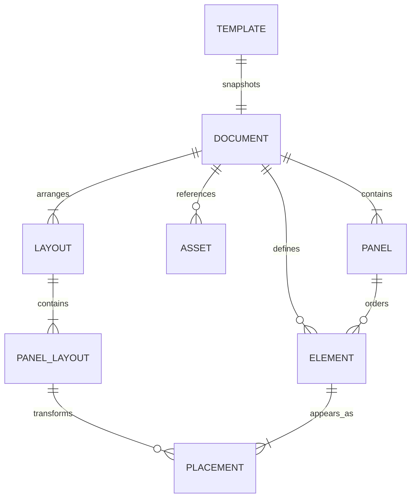

# 구조와 데이터 흐름

현재 앱은 React·TypeScript·Vite로 만든 정적 웹 앱입니다. npm workspaces로 화면과 공통 패키지를 나누고, 브라우저 Canvas2D로 카드와 다운로드 파일을 그립니다. 서버 계정이나 유료 API 없이 편집기의 핵심 동작을 검증할 수 있는 구조입니다.

## 책임 분리

| 부분      | 책임                                                       |
| --------- | ---------------------------------------------------------- |
| 화면      | 반응형 도구, 직접 조작 손잡이, 입력 상태와 오류 안내       |
| 편집 코어 | 문서 변경의 검증, 좌표 변환, 그룹·레이어 연산, 세션 이력   |
| 문서 모델 | 런타임 스키마, 유효한 참조, 비율별 배치의 불변 조건        |
| 렌더러    | 글자 측정·줄바꿈·도형·클리핑·배경·변형의 공통 계산         |
| 저장·교환 | 템플릿 CRUD, 이미지 Blob 저장, 가져오기 검증과 원자적 반영 |

화면에만 별도의 카드 그리기 규칙을 두지 않았습니다. 미리보기와 출력이 같은 렌더러를 사용하며, 출력 크기가 바뀌어도 동일한 문서의 좌표와 서식을 해석합니다.

## 문서 모델

`Element`는 문구·말풍선·이미지·캐릭터·도형·컷 테두리의 내용과 서식을 담고, `Placement`는 특정 비율에서의 위치·크기·회전·반전·투명도를 담습니다. 내용과 배치를 분리해 다른 비율에서 수정한 위치가 기존 배치를 덮어쓰지 않게 했습니다.

좌표는 컷에 대한 정규화 값으로 저장합니다. 원·정사각형 같은 기본 도형은 먼저 실제 컷 픽셀에서 비율을 계산한 뒤 정규화하므로 세로 카드와 가로 카드에서도 같은 모양으로 추가됩니다. 회전된 요소의 독립 축 조절은 지역 좌표에서 계산하고 반대 변을 고정합니다.

배경은 작품 전체와 개별 컷에 적용할 수 있습니다. 컷 배경과 테두리는 기본 그룹으로 취급하고, 전체 기본 배경 외의 편집 대상은 레이어 선택 흐름에 연결합니다.

## 입력·저장 경계

이미지는 확장자만 신뢰하지 않고 크기·시그니처·MIME·실제 디코딩과 픽셀 범위를 확인합니다. JSON은 문법뿐 아니라 스키마 버전, 필수 항목, ID와 소재 참조, 이미지 본문·해시·크기, 실제 렌더링 가능 여부까지 검사합니다. 검증이 끝나기 전에 현재 작업이나 저장 목록을 교체하지 않습니다.

템플릿의 문서와 이미지 Blob은 IndexedDB의 같은 트랜잭션으로 저장합니다. 불러올 때는 새 ID를 발급하고 참조를 다시 연결해 원본 템플릿과 편집 중인 카드가 독립적으로 유지됩니다. 늦게 끝난 비동기 작업은 문서·선택·비율이 바뀐 상태를 덮어쓰지 못하도록 취소합니다.

저장된 템플릿과 현재 미저장 편집 세션은 구분합니다. 브라우저 저장은 사용자가 데이터를 지우거나 기기를 바꿀 때 사라질 수 있으며, 계정 동기화나 서버 백업을 제공한다는 뜻이 아닙니다.

## 공개본의 생성 경계

공개 저장소의 수정은 원본으로 되돌리지 않습니다. 수정 요청이 생기면 비공개 원본에 반영한 뒤 같은 내보내기 절차를 다시 실행합니다. 전체 대화, 원문 기획·과제 자료, 사용자 원본, 원시 운영 로그, 인증 정보와 배포 내부 식별자는 공개 문서에 포함하지 않습니다.
